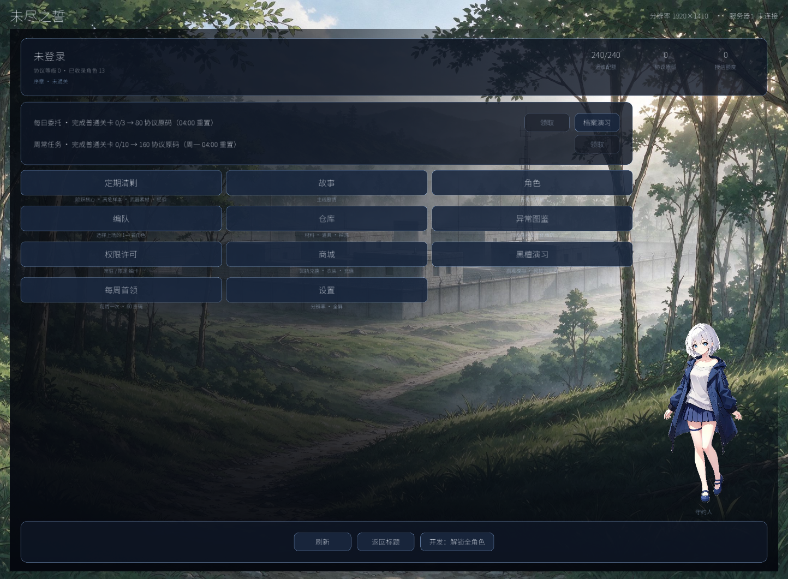

# 未尽之誓 / WaningOath

> **延绵若梦，终至如约。**

《未尽之誓》是一款现代都市 × 异常收容题材的回合制养成游戏。

「弥尘」泄漏之后，世界被重新划分：UNEG 守着旧秩序，CCRF 收容异常，掠夺者在无管制区讨生活，
而暴风眼在这一切之间维持着一块不设防的地方。你将作为一个被「约定」绑来的人，从 Site 14 的后山醒来。




## 玩法

- **战斗**：行动条驱动的回合制。八种属性各自积累异常条，叠满触发异常；同一次行动窗口里凑齐多种属性
  即产生「紊乱」。全队共用一条「共鸣指数」——普攻换共鸣，共鸣换节奏。
- **养成**：等级 80、四次突破、技能 14 级、**权阶协议**（同卡突破 6 阶）、武器**权限覆写** 5 阶、
  六部位角色专属套装。角色面板由「等级 + 突破 + 武器 + 装备」逐层折算，全部在服务端结算。
- **获取**：角色与武器通过「权限申请」取得。160 协议原码一次，五星 0.6%，55 抽软保底、80 抽小保底，
  角色可歪、武器不歪。

当前版本开放**序章**（S0–S9 全流程）与 **13 名可玩角色**，配套战斗、养成、权限申请与收容图鉴。

## 项目构成

| 层 | 技术 | 职责 |
|-|-|-|
| 客户端 | Godot 4.7.1（.NET 版）+ C# | 全部界面由代码搭建，容器布局，无绝对像素定位 |
| 战斗内核 | .NET 9 | 行动条、伤害管线、属性异常、权阶、装备与确定性 RNG |
| 服务端 | .NET 9 | 存档权威、成长与关卡结算、权限申请、战斗重放校验 |
| 离线模拟 | .NET 9 | 批量对战、验算用例、配装体检、数据校验 |
| 数据 | JSON | `data/` 下的角色 / 状态 / 武器 / 套装 / 关卡 / 规则表 |

服务端是唯一权威：进度与结算全部在服务器侧完成，客户端不保留进度副本；上报的战斗结果会由服务端
用同一份指令重算并比对日志指纹，对不上即拒绝。

## 目录结构

```
WaningOath.sln              解决方案（四个工程）
Directory.Build.props       共用编译设置（警告即错误）
nuget.config                离线包源

data/                       游戏静态数据
WaningOath.Core/            战斗内核 + 数据模型 + 校验器
WaningOath.Sim/             命令行模拟器
WaningOath.Server/          游戏服务端
WaningOath/                 Godot 客户端
tools/                      构建、运行、冒烟与诊断脚本
docs/screenshots/           界面预览
```

## 构建

需要 **.NET SDK 9** 与 **Godot 4.7.1（.NET 版）**。把 Godot 解压到
`Godot4/Godot_v4.7.1-stable_mono_win64/`——`nuget.config` 的离线包源指向它自带的 `GodotSharp\Tools\nupkgs`。

```bat
tools\build.cmd              :: 四个工程
tools\run-sim.cmd validate   :: 数据校验
tools\run-server.cmd         :: 启动服务端
tools\run-client.cmd         :: 启动客户端
```

界面中文字体使用 Noto Sans SC，放到 `WaningOath/Assets/Fonts/NotoSansSC-VF.ttf`；
美术资源与字体不随仓库分发，见 [ASSETS.md](ASSETS.md)。

## 参与贡献

- 提交前请确保 `tools\build.cmd` 零警告零错误，且 `tools\run-sim.cmd validate` 为 0 错误。
- 改动客户端界面时，请一并跑 `tools\godot-smoke.ps1`（22 屏 × 两种分辨率）。
- 改动数值或角色数据时，请先跑 `tools\run-sim.cmd batch` 看批量结果，再决定是否落盘。
- 提交信息请说明「改了什么、为什么」；涉及数值的请附上模拟对比。
- 发现 bug 或想讨论设计，开 issue 即可。

## 许可

| 范围 | 许可证 |
|-|-|
| 源代码 | PolyForm Noncommercial License 1.0.0 — [LICENSE](LICENSE) |
| 内容（数据、剧情脚本、文档、图标） | CC BY-NC 4.0 — [LICENSE-CONTENT](LICENSE-CONTENT) |
| 美术资源 | 不随仓库分发 — [ASSETS.md](ASSETS.md) |
| 第三方组件 | 各自的许可证 — [NOTICE](NOTICE) |

本项目仅供非商业用途；商业授权请与制作组联系。

## 致谢

见 [CREDITS.md](CREDITS.md)。
